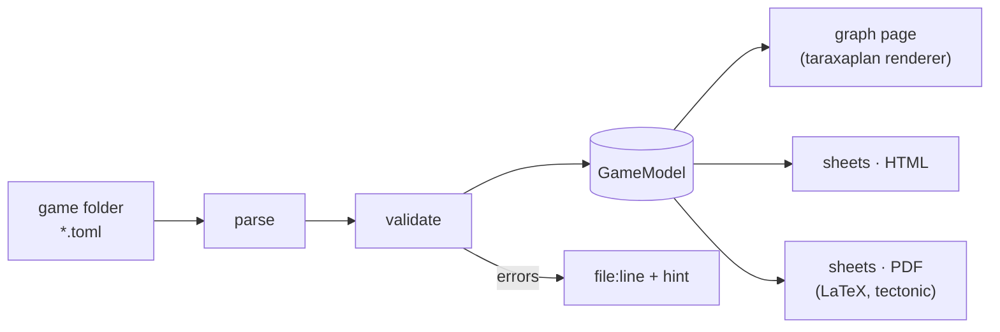

# larpidarium

Write your LARP as a folder of TOML files. larpidarium checks it, draws the plot as an interactive
graph in the browser, and prints character sheets for players and schedules for organizers as
HTML and LaTeX PDFs. Czech and English.

> **Status:** `check`, `build` and `serve` (editing in the browser) work; `pdf`, `import` and
> `schema` are not implemented yet. See the roadmap.

## Try it

```sh
cargo run -- serve examples/lost-abbey --open   # graph in your browser, editable
cargo run -- build examples/lost-abbey --open   # read-only static site in dist/
cargo run -- check examples/lost-abbey          # just validate
cargo run -- check examples/flawed-abbey        # a game full of planted problems
```

Character sheets land in `dist/players/`; open them from the 📄 icons in the graph sidebar.
See [`examples/README.md`](examples/README.md) for what is planted where.

```text
✔ Ztracené opatství: 6 actions (2 decisions), 4 people, 3 rooms, 3 items, 6 info · 0 warning(s)
```

Now break something, for example change `"rusty-key"` to `"rusty-kee"` in
`examples/lost-abbey/actions/crypt-door.toml`, and run it again to see the error report.

## How it works



The plot is a graph of **actions**. Each action *needs* some items and *gives* others; when one
action gives what another needs, they are connected. **Decisions** are actions with options.
**People** and **rooms** own actions. Details: [`docs/format.md`](docs/format.md).

## Planned usage

```sh
larpidarium check  my-game/          # validate, show errors with file and line   (works)
larpidarium serve  my-game/          # edit in the browser, live reload           (works)
larpidarium build  my-game/ --open   # static site in dist/, works offline        (works)
larpidarium pdf    my-game/          # player and organizer PDFs
larpidarium import plan.json         # convert a taraxaplan save to TOML
```

## Development

```sh
./scripts/install-tools.sh   # once: just, taplo, typos, cargo-deny, nextest, llvm-cov, machete, mutants
just setup                   # once per clone: enable git hooks
just                         # list all recipes
just ci                      # run everything CI runs
```

More in [`CONTRIBUTING.md`](CONTRIBUTING.md). AI agents follow [`CLAUDE.md`](CLAUDE.md); how the
AI-assisted workflow works is in [`docs/workflow.md`](docs/workflow.md).

## Roadmap

| Phase | Content                                                                          |
| ----- | -------------------------------------------------------------------------------- |
| 0 ✅  | Skeleton, checkers, CI, AI agent setup, docs                                     |
| 1 🚧  | TOML format ✅, segments ✅, logic levels 1–2 ✅, example games ✅, `serve` + browser editing ✅, JSON Schema |
| 2 🚧  | Graph: item edges ✅, auto layout ✅, viewer ✅, `build` ✅, summary tabs ✅, hero cycles + timeline ✅, map of the places ✅, "from here on" ✅, `import` |
| 3 🚧  | Game logic: playthroughs ✅, endings ✅, people ✅, lives ✅, "Game health" panel ✅; load per organizer and room ([spec](docs/game-logic.md)) |
| 4 ✅  | Character sheets in HTML: Part I who you are, Part II destiny from the graph, Part III how you change ([spec](docs/sheets.md)) |
| 5     | PDF: LaTeX templates, TikZ destiny graph, tectonic                               |
| 6     | Organizer sheets, mutation-testing cleanup, releases                             |

## License

[WTFPL](LICENSE). The graph renderer in `web/` is adapted from
[taraxaplan](https://github.com/Karlord19/taraxaplan) by Karlord19 under the MIT license, which
is kept in `web/LICENSE-taraxaplan`.
