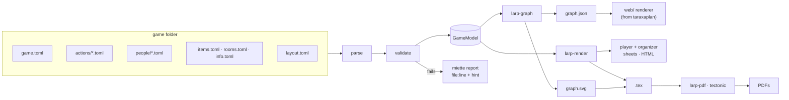
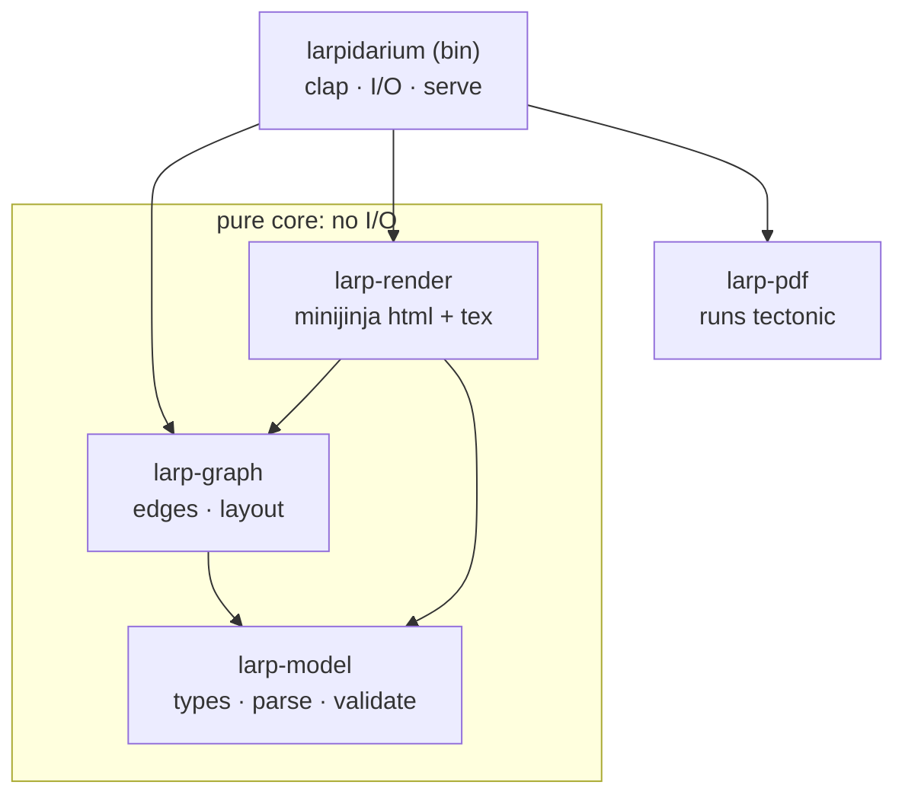

# Architecture

## Data flow



## Crates



Arrows mean "depends on". The pure core takes values and returns values, which keeps it fast to
test. Only the binary reads and writes files and only `larp-pdf` spawns a process.

## Output layout (`dist/`, phase 2+)

```text
dist/
├── index.html          # graph page
├── graph.json          # nodes, edges, colors, positions
├── assets/             # renderer JS/CSS (adapted from taraxaplan)
├── players/<id>.html   # one sheet per character
├── organizers/<id>.html
└── pdf/                # after `larpidarium pdf`
```

## Graph semantics

An edge `A → B` exists when action (or decision option) A *gives* an item that action (or option)
B *needs*. Edges are never written by hand. Validation reports:

- **error:** reference to an unknown id (item, person, room, action);
- **error:** item needed but never given and not marked `starting = true`;
- **warning:** item given but never needed;
- **warning:** action unreachable from any starting item.

## Layout

`larp-graph` computes a left-to-right layered layout from the dependency order. Positions and
bend points saved from the browser ("Save layout") go to `layout.toml` and override the
computed ones for those nodes.
