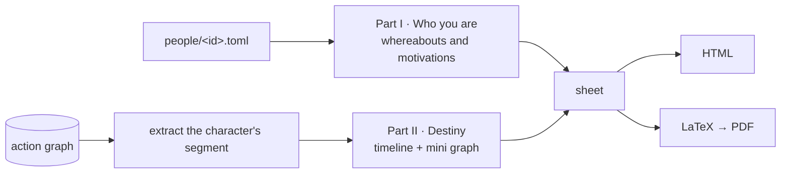
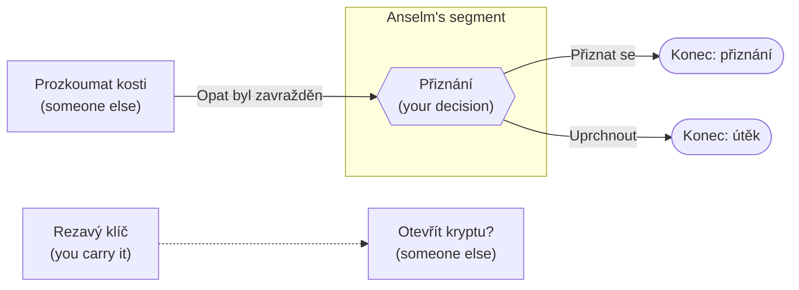

# Character sheets (draft)

> HTML player sheets are implemented (`larpidarium build`). PDF and organizer sheets are not yet.
> Decisions made on 2026-11-27 are marked ✅.

Every person with `role = "player"` gets a sheet. Organizers and NPC players get an organizer
version (see the end). A sheet has two parts:



## Part I: Who you are (whereabouts and motivations)

Written by hand in the person file. Nothing here is computed.

| Section                | Source key                      |
| ---------------------- | ------------------------------- |
| Name, role             | `name`, `role`                  |
| Appearance             | `sheet.appearance`              |
| Backstory              | `sheet.backstory`               |
| Where you are at start | `sheet.whereabouts`             |
| Goals                  | `goals`                         |
| Secrets                | `secrets`                       |
| Relations              | `[[person.relation]]` ✅        |
| What you carry         | items/info with `owners` containing this person and `starting = true` (computed) |

```toml
# people/brother-anselm.toml
[person.sheet]
appearance  = "Vysoký, shrbený, vždy s klíčem na krku."
whereabouts = "Na začátku hry jsi v kryptě a modlíš se."

[[person.relation]]
with = "novice-marta"            # checked: must be a person
text = "Marta ti připomíná sestru. Nevěříš jí."
```

## Part II: Destiny

Computed from the graph: the **segment** of the plot this character takes part in.

1. **Own nodes:** every action and decision where the character is an owner.
2. **Inputs:** for each thing an own node needs: "you carry it" (starting item of this character),
   "you got it earlier" (another own node), or "you will learn / receive it". ✅ Other characters
   are **not named**.
3. **Outputs:** what each own node gives. ✅ The sheet does not say who needs it next.
4. **Choices:** owned decisions with their options and what each option leads to.
5. **Order:** nodes sorted by graph layer, so Part II reads as a timeline (early → late).
6. ✅ **Both** a timeline and a **mini graph**: the same segment drawn small, own nodes
   highlighted, neighbors as anonymous grey boxes. SVG in HTML, TikZ in the PDF, from the same
   coordinates.



✅ Player-facing text is the action's `brief` key; `text` stays for organizers only.
Items listed in `uses` are shown as "you will give up / use up …".

## Organizer sheet

Same data, other angle: every node the person or room owns, in time order, with full
organizer `text`, everything needed (what to prepare, where it comes from), and what to hand out.

## Output

- HTML: `dist/players/<id>.html`, `dist/organizers/<id>.html`, linked from the graph sidebar.
- PDF: `dist/pdf/<id>.pdf` via minijinja `.tex.j2` templates and tectonic; Czech/English labels.
