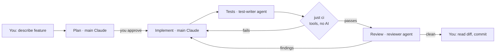
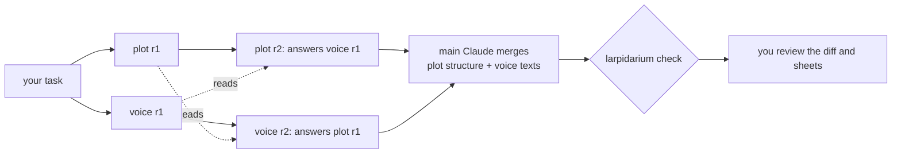

# Working with AI agents

This project is built with Claude Code. This page explains the setup for someone new to it.

## The loop



Two rules make this trustworthy:

1. **Pass or fail is decided by tools** (`just ci`), never by an AI saying "looks good".
2. **The reviewer did not write the code.** It is a separate agent with a fresh context and no
   edit permission.

## Pieces

| File                          | What it does                                                    |
| ----------------------------- | --------------------------------------------------------------- |
| `CLAUDE.md`                   | Rules every Claude session reads first                          |
| `.claude/settings.json`       | Commands Claude may run without asking; format hook after edits |
| `.claude/agents/test-writer.md` | Writes tests; may only touch test code                        |
| `.claude/agents/reviewer.md`  | Reviews the diff; read-only                                     |
| `.claude/agents/docs-keeper.md` | Keeps docs and the example game in sync                       |
| `.claude/agents/copywriter-plot.md` | Game content: plot, conflicts, decisions (drafts only)    |
| `.claude/agents/copywriter-voice.md` | Game content: language, tone, briefs (drafts only)       |
| `.claude/skills/writers-room/SKILL.md` | `/writers-room`: runs both copywriters in rounds       |

## Typical session

```text
you:    Plan phase 1: the TOML format and `larpidarium check`.
        (Shift+Tab switches to plan mode: Claude only reads and proposes.)
claude: <plan>
you:    OK, go.
claude: <implements, runs just ci>
you:    Use the test-writer agent on larp-model, then the reviewer agent.
claude: <tests added, review findings fixed>
you:    Commit it.
```

Useful built-ins: `/code-review` (deeper bug hunt), `/simplify` (cleanups), `/init` is not needed
because `CLAUDE.md` exists. Run `/agents` to see the project agents.

## Two copywriters in parallel: the writers' room

Two agents write game content and improve each other's drafts:

| Agent              | Strength                                                          |
| ------------------ | ----------------------------------------------------------------- |
| `copywriter-plot`  | conflicts, secrets, player decisions, how items connect actions    |
| `copywriter-voice` | language, atmosphere, Czech style, short spoiler-free player texts |



**Parallel** means both agents run at the same time: Claude starts them in one message, and you
wait for the slower one instead of both in turn. They never talk to each other directly. Each
writes a draft file in `drafts/<game>/<topic>/`, and in the next round each reads the other's file.
Only the main session edits the game's TOML, so the two agents can never overwrite each other.

### Easiest: the command

```text
/writers-room examples/lost-abbey add a fourth player, a herbalist who knows about the poison
/writers-room examples/lost-abbey rewrite all briefs to be more atmospheric rounds=3
```

### By hand, to learn what happens

```text
Use copywriter-plot and copywriter-voice in parallel. Game: examples/lost-abbey.
Task: give Novicka Marta a stronger secret. Drafts: drafts/lost-abbey/marta-secret/. Round 1.
```

Then, after both finish:

```text
Round 2, again both in parallel: each reads the other's r1 draft, responds, writes r2.
```

And finally: `Merge the r2 drafts into the game, run check and build, show me the diff.`

Tips: watch the agents with `/agents` or the task list while they run; the drafts are plain
Markdown you can edit yourself between rounds; two rounds are usually enough.

## Why mutation testing

AI-written tests can look thorough and test nothing. `just mutants` changes the code on purpose
(for example `<` to `<=`) and checks that some test fails. A "surviving mutant" is a bug your tests
would miss; hand it to the test-writer agent.
